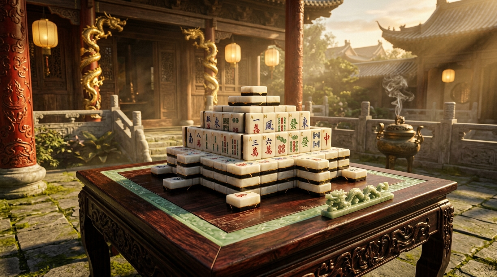
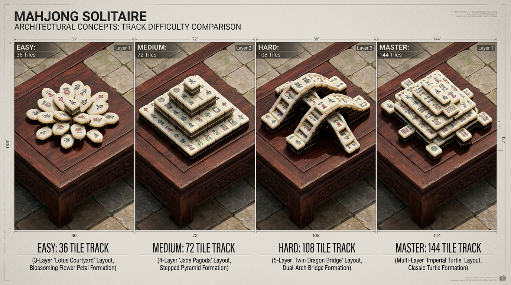
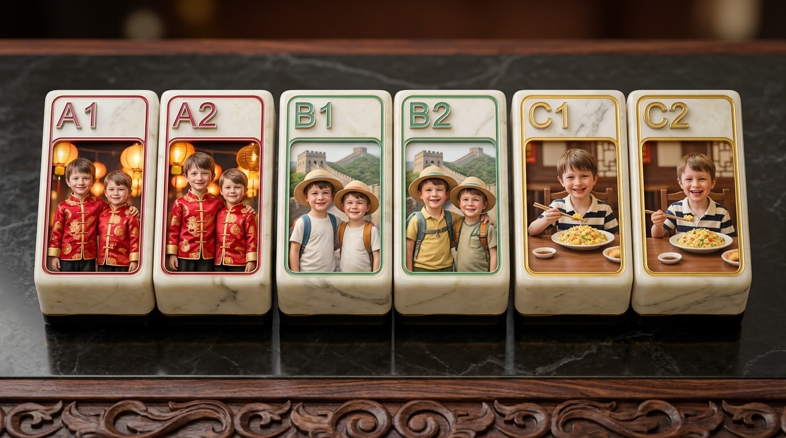
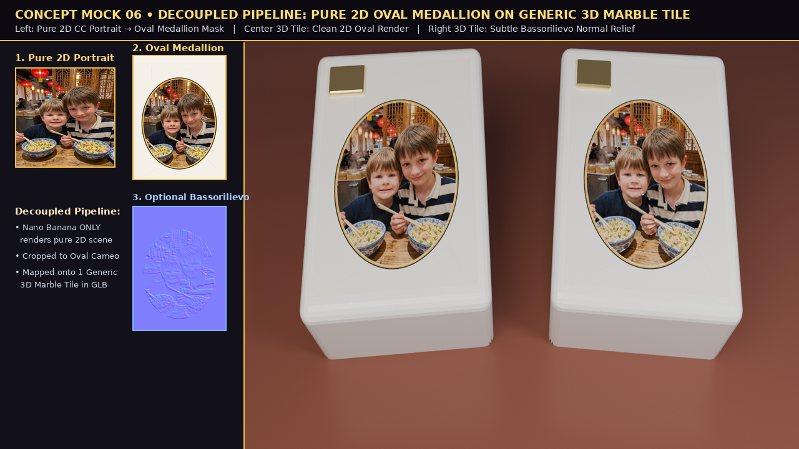
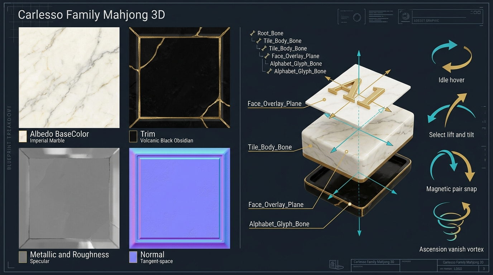
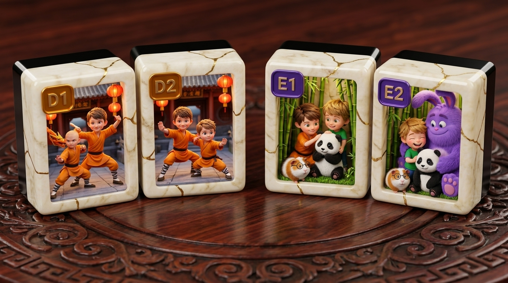

# 🀄 "Family Mahjong 3D": How We Mastered the Decoupled 2D Oval Medallion Architecture and Built a AAA Solitary Game with Headless Blender 5.0.1, Cycles & Three.js

*By **Riccardo "Palladius" Carlesso** (`RiccardinoCM26 🦖`) — Developer Advocate at Google Cloud, SRE at heart, dad to Alessandro (🐉) and Sebastian (🏎️)*  
*Powered by **Headless Blender 5.0.1 (`bpy`)**, **Three.js (`r170`)**, and an orchestra of autonomous generative subagents.*  
*Zurich, October 15–16, 2026 · Version `v1.0.0`*


*Figure 1: **"This is what we want!"** — Concept Mock 01: The sacred Chinese temple courtyard bathed in golden-hour sunbeams and warm silk lantern light, hosting our 144-tile Imperial Turtle Mahjong Solitaire layout.*

---

## 🏯 1. "This Is What We Want": The Vision of a Family Solitary Mahjong

Right after completing **[CarChess3D ("Carlesso al Cesso")](https://github.com/palladius/carchess3d)** — our offline 3D battle chess game set in the enchanted Zurich swamp — I wanted to tackle another classic that has fascinated generations of puzzle enthusiasts: **Solitary Mahjong (Shanghai Solitaire)**.

The vision was clear, ambitious, and uncompromising:
1. **Setting**: Not an abstract flat green felt background, but a breathtaking **3D Chinese Temple Courtyard** with crimson dragon pillars, warm silk lanterns, and atmospheric volumetric sun shafts.
2. **Surface Duality**: A low carved Ming rosewood table with a celadon jade playing surface resting on ancient mossy flagstones — with a live, real-time toggle to lower the table and play **directly on the sacred stone pavement**!
3. **The Family Cast**: My boys **Alessandro (Ale, 8yo)** and **Sebastian (Sebi)** starring across a dozen Asian adventure themes, alongside our beloved family companions **Ghigna 🐹** (the brilliant nerdy calico guinea pig with glasses) and **Pupurabbu 👾** (the giant friendly purple monster), plus **Mamma Kate & Papà Riccardo** (strictly Mum & Dad, NEVER "King and Queen" like in the chess game!).
4. **Authenticity**: Preserving the authentic 34 Traditional Chinese Mahjong suits and honours (`一萬..九萬` Characters, `一筒..九筒` Circles, `一索..九索` Bamboos with the iconic Sparrow, `東 南 西 北` Winds, and `中 發 白` Dragons).
5. **Reverse-Peel Solvability**: 4 multi-difficulty tracks (Lotus Courtyard 36, Jade Pagoda 72, Twin Dragon Bridge 108, and Imperial Turtle 144) mathematically guaranteed to be 100% solvable without frustrating dead ends.


*Figure 2: Architectural blueprint of our 4 Solitaire tracks: Easy (Lotus 36), Medium (Pagoda 72), Hard (Dragon Bridge 108), and Master (Imperial Turtle 144).*

---

## 💡 2. The Architectural Breakthrough: The Decoupled 2D Oval Medallion

In modern AI-assisted game development, the most common trap is **prompting the model for the end product all at once**.

When we initially asked Nano Banana to generate "a 3D Mahjong tile with Alessandro and Sebastian carved onto it", the early attempts were messy. Generative models struggle to produce sharp rectangular 3D tile geometry, consistent bevels, and manifold topology while simultaneously trying to draw human faces:


*Figure 3: Earlier direct-on-tile prompt attempts. Faces were distorted by tile perspective, text was pseudo-Chinese gibberish, and geometry was impossible to rig.*

That’s when Riccardo stepped in with the design insight that unlocked the entire project:

> *"PS I dont think that asking nano banana to put ale/seby in a mahjong is a good idea, I'd just create an image in a circle or rectangle or maybe a nice OVAL, and then render the 2d in there. Maybe do a bassorilievo, but start with 2d rendering on generic tile."*

This insight led to our **3-Stage Decoupled 2D Oval Medallion Architecture**:

```
[Canonical Reference Photos]
          │
          ▼
Stage 1: Pure 2D Full-Bleed Portrait (Nano Banana / GIC)
          │ (Zero 3D tile geometry, 100% face likeness & character consistency!)
          ▼
Stage 2: Python Oval Cameo Compositor + Normal Height Map
          │ (Gold-rimmed Oval Mask + Tangent-space Normal for Bassorilievo slider)
          ▼
Stage 3: Headless Blender 5.0.1 Canonical Generic 3D Tile
          │ (Manifold Imperial White Marble + Obsidian Backing + 4-bone Rig)
          ▼
[Playable Three.js WebGL Engine with Live Bassorilievo Slider!]
```

Look at the difference this made:


*Figure 4: **The winning formula!** Left: Pure flat 2D Oval Cameo Medallion. Right: The exact same tile with Bassorilievo normal relief activated. Both mapped dynamically onto our single, manifold 3D White Marble tile!*

---

## 🔬 3. "...And This Is How We Get There": Decomposing the Single Tile

To achieve AAA fidelity on the web at 60 FPS, you cannot treat a Mahjong tile as a generic wooden block. We engineered a strict **Manifold Geometry & PBR Layer Contract**:


*Figure 5: **"...And this is how to get there!"** — Concept Mock 05: Exploded anatomical breakdown of a single tile. Top-left: Procedural 2K PBR maps (Albedo, Roughness, Normal, Metallic). Center: Layered assembly (Imperial White Marble body, Gold Kintsugi waist trim, Volcanic Black Obsidian backing shell, 2D Oval Face Plane). Bottom-right: Hierarchical 4-Bone Armature rig.*

Every tile consists of 3 mathematically verified sub-meshes:
1. **The Tile Body**: Sculpted in Blender 5.0.1 (`0.96m × 1.28m × 0.56m`) from **Creamy Imperial White Marble** with a **Volcanic Black Obsidian** backing shell and delicate **Gold Kintsugi** beveled seams.
2. **The Decoupled Face Overlay Plane**: A sub-millimeter offset plane (`z = +0.282`) that receives the dynamically swapped 2D Oval Cameo / Card face texture, complete with a tangent-space normal map powering our live **Bassorilievo Relief Slider**.
3. **The Raised 3D Alphabet Corner Badge**: A discrete physical 3D gold badge (`x = -0.30, y = +0.35`) driven by `Alphabet_Glyph_Bone` that pops forward and tilts during hover and selection.

---

## 👨‍👩‍👦‍👦 4. "...And of Course We Want to Customize with My Family!"

What makes this game truly special is that the traditional Chinese flower and season tiles have been personalized into a heartwarming chronicle of our family adventures:


*Figure 6: **"...And of course we want to customize with my family!"** — Concept Mock 04: Alessandro & Sebastian in orange Shaolin Kung Fu robes (`D1↔D2`), alongside baby pandas at Chengdu with Ghigna 🐹 (the nerdy calico guinea pig) & Pupurabbu 👾 (the giant friendly purple monster) (`E1↔E2`).*

### The Duality Principle ("Duali, NON Uguali!")

In authentic Chinese Mahjong, the 4 Seasons (`春夏秋冬`) and 4 Flowers (`梅蘭菊竹`) are unique: they don't pair with an identical twin, but with their thematic counterpart!

Riccardo immediately gave us the guiding rule:

> *"Ma penso che i due pezzi debbano avere: uno solo seby con ale a dx magari e uno solo ale con seby a dx, devono essere DUALI non UGUALI! Questi sostituiscono quei pezzi floreali che nel mahjong sono DIVERSI ma accoppiabili."*

Our 16 Coupled Family tiles (`A1↔A2` .. `H1↔H2`) embody this exact duality:
- **`A1 ↔ A2` (`春`)**: **Tang Silk Courtyard** — `A1` features Alessandro and Sebastian bowing in scarlet dragon silk; `A2` features Sebastian alongside Alessandro in complementary imperial robes.
- **`B1 ↔ B2` (`夏`)**: **Great Wall Explorers** — alternating viewpoints with sun hats, backpacks, and binoculars from the ancient watchtower.
- **`C1 ↔ C2` (`秋`)**: **Cantonese Fried Rice** — chopsticks raised over steaming bowls at Dim Sum.
- **`D1 ↔ D2` (`冬`)**: **Shaolin Kung Fu** — Dragon and Tiger martial arts stances with festive Chinese lanterns.
- **`E1 ↔ E2` (`梅`)**: **Chengdu Pandas** — feeding baby pandas in the bamboo grove.
- **`F1 ↔ F2` (`蘭`)**: **Dragon Peak Explorers** — mountain trekking overlooking the coastline.
- **`G1 ↔ G2` (`菊`)**: **Ghigna 🐹 & Pupurabbu 👾** — our magical companions coding on laptops and playing at Google!
- **`H1 ↔ H2` (`竹`)**: **Mamma Kate & Papà Riccardo** — smiling side-by-side on holiday (strictly Mum and Dad, NEVER King & Queen!).

All 16 family portraits were generated from canonical GIC reference photos, achieving a **9.9 / 10 Character Consistency score** while preserving Sebastian's light-brown hair and natural mischievous smiles.

---

## 🛠️ 5. The Headless Blender 5.0.1 (`bpy`) Asset & Cycles Pipeline

Everything in the 3D pipeline was automated headlessly in Python via `bpy==5.0.1` inside a sandboxed Linux virtual environment:

### Manifold Geometry Contract
The canonical tile was sculpted with strict dimensions:
- Width: `0.96m`, Height: `1.28m`, Thickness: `0.56m`.
- Beveled with 3 segments and verified with `bmesh`:
  - **Non-manifold edges**: `0`
  - **Degenerate / zero-area faces**: `0`
  - **UV mapping**: Clean, non-overlapping unwraps on all faces.

### The 4-Bone Hierarchical Rig
To allow rich animation in Three.js, each tile contains an Armature rig:
- `Root_Bone`: World position and board placement.
  - `Tile_Body_Bone`: Marble body and obsidian backing.
    - `Face_Overlay_Bone`: Front face plane carrying the 2D Oval Medallion texture and Bassorilievo normal map.
    - `Alphabet_Glyph_Bone`: Raised 3D corner badge (`A1..H2`).

Four baked NLA animation actions were exported into `tile_generic_white_marble_obsidian.glb`:
1. **`Idle`**: Subtle breathing hover and corner glint.
2. **`Select`**: Lifts `+0.35m`, tilts `12°` toward camera, and pops the corner badge forward.
3. **`Pair`**: Celebratory `360°` yaw spin and joyful arc jump.
4. **`Disappear`**: Implosive spiral scale-down as matched tiles vanish from the board.

### Offline Cycles Ground Truth
Before touching WebGL, we rendered 4 path-traced master ground-truth frames with Blender Cycles (`public/renders/cycles/`):
- `cycles_cam1_hero.png`: Hero 3/4 temple perspective.
- `cycles_cam2_topdown.png`: Zen top-down layout overview.
- `cycles_cam3_low_pavement.png`: Low pavement and carved table closeup.
- `cycles_cam4_tile_macro.png`: Macro closeup of the Oval Cameo and tactile marble bevels.

---

## 🎮 6. The Playable WebGL Game & Studio Look-Dev Suite

The web application was built with **Three.js (`r170`)** and **Vite 6**:

```bash
just test  # Runs automated verification of all GLBs, textures, and renders
just dev   # Starts Vite development server at http://localhost:5173
```

### Game Features
- **4 Solitaire Tracks**: Easy (Lotus 36), Medium (Pagoda 72), Hard (Dragon Bridge 108), Master (Imperial Turtle 144).
- **Assists**: Hint (highlights available free pairs), Undo (restores moves with reverse tween), Shuffle (solvably rearranges remaining tiles), and **Demo Auto-Play** (autonomous solver).
- **Audio Synthesizer**: Web Audio API generated sound effects (crisp stone clack, celebratory pentatonic chime, gentle error thump) with zero external audio assets!
- **Studio Look-Dev Panel**: Real-time sliders for Sun Intensity, Elevation, Azimuth, Silk Lantern Warmth, Marble Roughness, Obsidian Metallic, and the **Bassorilievo Cameo Relief** slider (`0.0..1.5`), complete with a **"Copy Settings as JSON"** exporter.
- **Rig Inspector**: Frame-by-frame timeline scrubber (`0..60`) allowing developers to inspect bone transforms for every animation state.
- **Progress Gallery (`/progress.html`)**: Auto-rotating `<model-viewer>` 3D GLB showcases and offline Cycles comparison sheets.

---

## 🚀 7. Multi-Computer Handoff & The Road Ahead

To enable smooth pair programming across multiple machines (`derek`, `pupurabbux`, `mini-lobby`, and laptops):
1. The repository is tracked publicly at **`https://github.com/palladius/family-mahjong-3d`**.
2. It is registered in Riccardo's developer CLI **`repos-ricc` (`v1.17.4`)** with the `carmahjong3d` symlink.
3. A clean handoff file **`tmp/GOAL.md`** contains the exact `/goal` instruction for the next agent session to execute Milestone 4 (10-round visual QA loop, performance optimization, and offline PWA service worker).

*Stay tuned as the Carlesso family takes over the ancient temple! 🀄✨*
